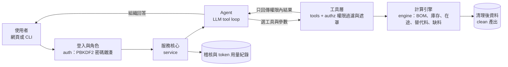

# PartPilot：LLM 料件智慧問答 Agent

> **PartPilot** is an LLM agent that lets procurement, production-planning and product-line staff query part data in plain language.
> All numbers are computed by a deterministic Python engine; the LLM only understands the question, picks tools and writes the answer.
> Role-based filtering happens in the tool layer, so the model never sees data the user is not allowed to see.

## 一句話說明

PartPilot 讓製造業的採購、生管與產品線人員用自然語言查料件資訊（BOM、庫存、在途、替代料、缺料），不必再翻多張報表或寫 SQL，而且每個人只會看到自己權限內的資料。

## 可以做什麼

- **BOM 展開**：依生產日與數量展開多階 BOM，算出原料需求與零件位置。
- **反查上階**：查某顆料被哪些半成品、成品使用，以及使用路徑。
- **料件屬性**：查料號主檔與材料屬性，例如類別和 RoHS。
- **可用庫存**：依生產日只計算合格、未過期的庫存，可以依廠區彙總。
- **在途採購**：列出生產日前可到貨的在途，以及會晚到的採購。
- **替代料**：依主料、上階、成品與生產日判斷替代料能不能用，並說明不能用的原因。
- **缺料試算與應變**：算出做 N 台缺哪些料、最多能做幾台；交期延長或停產時，分析影響哪些成品、有哪些替代料，以及新下單的預計到貨日。
- **權限過濾**：依角色、產品線、廠區與物料群組過濾，範圍外的料號、廠區資料不會回傳。
- **敏感欄位遮罩**：供應商名稱、製造商料號、單價依角色移除；供應鏈主管只可看匿名單價統計，筆數少於 4 時不顯示；零件工程師可查自己範圍內的單價明細。
- **資料清理與人工確認佇列**：統一料號、廠區與日期格式，排除無效資料；有歧義的資料進入待確認佇列，由負責該物料群組的人核准或駁回。
- **稽核與 token 用量紀錄**：每次登入、提問、工具呼叫都寫進稽核紀錄，並記錄每輪 LLM 的 token 用量與估算成本。

## 問答範例

以下料號都存在於 `data/sample/` 的範例資料。

**demo 模式（不需 API key）可以直接問的句型：**

- BOM：「SA100101 的 BOM」
- 反查：「CAP-000101 用在哪裡」
- 庫存：「PLANT-A CAP-000101 庫存」
- 在途：「2026-11-20 PLANT-A CAP-000101 在途」
- 替代料：「CAP-000101 的替代料，上階 SA100101，成品 FGD101-01」
- 缺料：「2026-11-20 PLANT-A 做 100 台 FGD101-01 缺什麼料」（可以在句尾加「納入在途與替代料」）

**比較口語的問法需接真實 LLM（`LLM_MODE=real`）**，例如：

- 「幫我比較下週各成品的缺料風險，並建議備料順序。」
- 「RES-000101 被哪些成品用到？下週一 PLANT-A 夠不夠用？」
- 「如果 MOS-000101 交期延長到 16 週，會影響哪些成品？」

## 架構



## 最重要的三個設計決定

1. **數字全部由 Python 引擎計算。** LLM 只負責理解問題、選工具、組織回答。BOM 用量、損耗、可用庫存、缺料台數都是程式算出來的，避免 LLM 算錯數字。
2. **權限在工具層先過濾。** 工具結果在交給 LLM 之前，就已經移除權限外的料號、廠區和敏感欄位，LLM 根本看不到這些資料，所以就算被誘導也無法洩漏。
3. **LLM 包成單一介面。** Agent 只依賴一個 `create()` 介面，換 LLM 廠商只要換一個 client；另外有不需要 API key 的 demo 模式（`LLM_MODE=demo`），用關鍵字規則選工具，方便離線展示。

## 快速開始

**Docker**

```bash
docker compose up --build
```

打開 `http://127.0.0.1:18765`。

**本機 demo（不需 API key）**

```bash
python3 -m venv .venv && .venv/bin/pip install -r requirements.txt && bash scripts/demo.sh
```

**接真實 LLM**

複製 `.env.example` 為 `.env`，填入 `LLM_API_KEY`、`LLM_MODEL`，並設定 `LLM_MODE=real`。

**跑測試**

```bash
.venv/bin/python -m pytest -q
```

**命令列子指令**（`.venv/bin/python -m partpilot <子指令>`）

| 子指令 | 用途 | 誰能用 |
|---|---|---|
| `init-users` | 用 `PARTPILOT_INIT_PASSWORD` 建立預設帳號 | 部署者 |
| `clean --user sys_admin` | 執行資料清理 | 系統管理員 |
| `ask --user <帳號> "問題"` | 自然語言查詢；省略問題時進入互動模式，`--conv` 接續對話 | 具查詢權限的角色 |
| `review --user <帳號> [--approve ID \| --reject ID] [--choice N]` | 列出、核准或駁回待確認資料 | 零件工程師 |
| `audit --user sys_admin` | 查看稽核與 token 用量彙總 | 系統管理員 |
| `serve [--host] [--port]` | 啟動網頁，預設 `127.0.0.1:18765` | — |

## 預設帳號與角色

所有帳號的初始密碼都取自環境變數 `PARTPILOT_INIT_PASSWORD`。首次用 `scripts/demo.sh` 或 Docker 啟動且未設定此變數時，會產生隨機密碼並在終端顯示，請自行保存。再次啟動時設定 `PARTPILOT_PASSWORD` 為原密碼；既有帳號不會被重設。CLI 可設定 `PARTPILOT_PASSWORD`，未設定時會提示輸入。Docker 可透過環境變數傳入設定，無須建立 `.env`。

| 角色 | 帳號 | 可查的範圍 | 供應商名稱／製造商料號 | 單價 | 其他 |
|---|---|---|---|---|---|
| 供應鏈主管 | `scm_lead` | 全集團料件 | 看不到 | 只看統計值（依類別或產品線） | — |
| 產品線經理 | `line_dc`、`line_ac` | 自己產品線（DC／AC）成品 BOM 涵蓋的料，以及其替代料 | 看不到 | 看不到 | 不會看到別的產品線的資料 |
| 工廠物控 | `plant_a`、`plant_b`、`plant_c`、`plant_d` | 全集團料件；庫存與在途只能看自己廠區（依序為 PLANT-A、PLANT-B、PLANT-C、PLANT-D） | 看得到 | 看不到 | — |
| 零件工程師 | `engineer_power`、`engineer_passive`、`engineer_ic`、`engineer_emech`、`engineer_mech` | 自己物料群組（功率半導體、被動元件、IC、機電與連接、機構與其他）的原料及其上階 | 看得到 | 看得到 | 可以核准或駁回自己群組的待確認資料 |
| 系統管理員 | `sys_admin` | 不能查料件 | — | — | 執行資料清理、查看稽核與 token 用量 |

## 怎麼做出來的

這個專案用多個 AI 工具協作完成：用 Claude Code 拆解需求和撰寫測試，由 Codex 實作，再做兩次獨立驗收。程式主要由 AI 產生，作者負責需求判斷、測試設計與驗證。

## 已知限制

- `data/sample/` 的範例資料是自產的假資料，不代表任何真實公司的料件、價格或供應商。
- demo 模式不呼叫 LLM，只認得上面列的固定句型；口語問法、相對日期、交期影響分析都需要真實 LLM。
- 正式使用需要接真實 LLM（設定 `LLM_MODE=real` 和 API key）。

## 作者

游覺輝，GitHub：[tateru199988121-arch](https://github.com/tateru199988121-arch)
